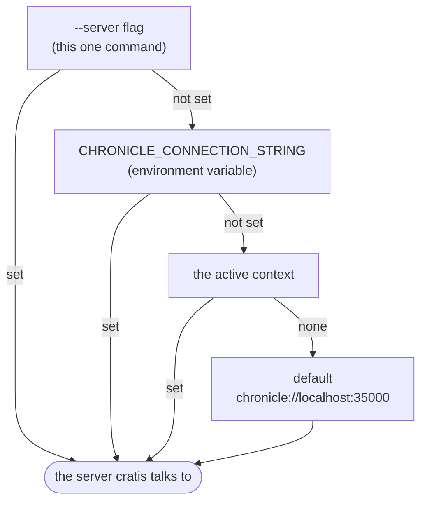

import { Steps, Tabs, TabItem, Aside } from '@astrojs/starlight/components';
import YouWillLearn from '@components/YouWillLearn.astro';
import Recap from '@components/Recap.astro';

Cratis CLI provides the `cratis` terminal command for inspecting Cratis Chronicle events and diagnosing processing failures. This tutorial takes you from installation to a connection report for a running store, then shows how to select another server. You can work entirely from a terminal, including over SSH; [Chronicle Workbench](/chronicle/workbench/) provides the browser alternative. Neither requires you to write inspection code.

<YouWillLearn>

- Install the `cratis` command for your machine.
- Check the configured context and test a Chronicle connection.
- Select another server without retyping its address for every command.

</YouWillLearn>

## Prerequisites

You need a running Chronicle store you are authorized to inspect. If you do not have one, follow the [Chronicle get-started](/chronicle/get-started/) first. With no connection overrides, the CLI targets `chronicle://localhost:35000`.

Choose Homebrew, a native release binary, or the .NET global tool for installation. The .NET tool targets .NET 10; its installation command below uses the .NET SDK.

## Install it

Pick one installation method. Each makes the `cratis` command available on your `PATH`.

<Tabs syncKey="cli-install">
  <TabItem label="macOS (Homebrew)" icon="apple">

  ```bash title="Install with Homebrew"
  brew tap cratis/cratis
  brew install cratis
  ```

  Homebrew manages this installation. See [updating the CLI](update.md) when you need a newer version.
  </TabItem>
  <TabItem label="Linux" icon="linux">

  Download the pre-built native binary from the [latest release](https://github.com/Cratis/cli/releases/latest) and put it on your `PATH`. Release assets are named with their version, so resolve the version first:

  ```bash title="Install the native binary"
  # x64 (Intel/AMD) — swap x64 for arm64 throughout for an ARM machine
  VERSION=$(curl -fsSL https://api.github.com/repos/Cratis/cli/releases/latest | grep -Po '"tag_name": "v\K[^"]*')
  curl -Lo cratis.tar.gz "https://github.com/Cratis/cli/releases/download/v${VERSION}/cratis-${VERSION}-linux-x64.tar.gz"
  tar -xzf cratis.tar.gz
  sudo mv cratis /usr/local/bin/cratis
  ```

  Check that the release provides the asset for your architecture. Native binary upgrades require downloading and replacing the binary; `cratis update` prints instructions rather than replacing it.
  </TabItem>
  <TabItem label=".NET tool" icon="seti:c-sharp">

  With the [.NET SDK](https://dotnet.microsoft.com/download) (10 or newer), install the global tool:

  ```bash title="Install as a .NET global tool"
  dotnet tool install -g Cratis.Cli
  ```

  This installation is managed by `dotnet tool`. See [updating the CLI](update.md) for the update command and its side effects.
  </TabItem>
</Tabs>

## Check the connection

<Steps>

1. Run `cratis` with no arguments in an interactive terminal to see the active context, a named connection, and its configured server URL. This displays saved settings without attempting a connection.

   ```bash title="Check the active connection"
   cratis
   ```

   On first use, the CLI sets up a `default` context. Without another server configured, Chronicle commands fall back to `chronicle://localhost:35000`. Environment variables and command flags can override that address, as explained below.

2. Test the server connection with `cratis get-started`. It also prints a guide to inspection commands.

   ```bash title="Test the connection and get a tour"
   cratis get-started
   ```

   Look for a successful connection in the report, not just a zero exit code: this command can return success even when it cannot connect.

</Steps>

<Aside type="tip" title="If the connection fails">
Check that the server is running and reachable from this terminal, then check the selected context and any `CHRONICLE_CONNECTION_STRING` override. For credentials and authentication, follow the [connection reference](/cli/reference/connection/). Run `cratis get-started` again after correcting the configuration.
</Aside>

## Keep it up to date

Follow [Update Cratis CLI](update.md) for the update procedure, installation-specific limits, template refreshes, and Stage image updates. Updating is separate from proving your first connection.

## How `cratis` decides where to connect

Chronicle commands use the first server setting they find: the `--server` flag, then `CHRONICLE_CONNECTION_STRING`, then the active context, and finally `chronicle://localhost:35000`. This order matters when a command reaches a different server from the one saved in your context.



With no overrides or configured server, the CLI uses the local address. The environment variable and `--server` flag let you select a server for automation or a one-off command without changing the saved context.

## Point it at another store

Use a context to save a server address you will need again. You can change `default` or leave it for local work and add a separate context for each environment.

With `default` selected as the active context, change its saved server:

```bash title="Change where 'default' points"
cratis context set-value server chronicle://myserver.example.com:35000/
```

Or keep `default` for local and add a named context, then switch the active one:

```bash title="Add and switch to a staging context"
cratis context create staging --server chronicle://staging.example.com:35000/
cratis context set staging
```

Chronicle commands now use staging unless the environment variable or an explicit `--server` overrides it. Run `cratis get-started` to check the connection before inspecting that store. For CI and containers, you can set `CHRONICLE_CONNECTION_STRING` instead of switching saved contexts. See [Context](../context/index.md) for the full workflow.

<Aside type="caution" title="Check the target before changing state">
Confirm the event store and namespace as well as the server before replay or recovery commands. Connection strings and context files can contain credentials; keep them out of source control and shared logs.
</Aside>

## Two niceties worth a minute

If you will use the CLI regularly, install tab completion so your shell can finish commands and options:

```bash title="Install shell completions"
cratis completions install
```

Restart your shell after installing completions. Use `--shell bash|zsh|fish|powershell` to select a shell explicitly.

If a coding assistant needs the command catalog, run `cratis init` inside your project. It generates `CHRONICLE.md` and assistant integration files describing the CLI's commands:

```bash title="Set up AI tooling"
cratis init
```

This is optional and separate from connecting to Chronicle. The generated catalog is a snapshot; after upgrading, use `cratis init --refresh` to regenerate it. Use `--no-context` when you must not add a `CHRONICLE.md` reference to a shared, generated instruction file. See [LLM context](/cli/reference/llm-context/) for the catalog surface.

## Recap

<Recap>

A successful connection in the `cratis get-started` report is your signal to continue with inspection. If it cannot connect, correct the server or authentication settings and repeat the check. For later commands, remember that a flag or environment variable overrides the saved context.

</Recap>

## Where to go next

For a first look at the store, open the [Chronicle command reference](/cli/chronicle/) and list its event stores before choosing what to inspect. If you already have a failure to investigate, follow a [scenario](/cli/scenarios/) for a stuck observer, projection replay, or checking appended events.

Use [Context](../context/index.md) when you need more saved connections. For an existing installation, [Update Cratis CLI](update.md) explains the update procedure and its side effects.
